# vrstudio 操作手册

本手册面向第一次使用 vrstudio 的同事，按三条流程说明从新建 case 到拿到成片的操作。

## 读图约定

手册里的截图都用两种记号帮助定位。

- 圆圈数字 ①②③④ 表示操作顺序，按数字从小到大依次操作。
- 红色方框表示需要细看的位置，通常框住一个按钮、一个状态标签或一处提示文字。
- 每张图下方的图注逐条解释编号含义，读者不必放大图片找字。

## 目录

1. 开始之前
2. 三条流程共用的页面
3. 局部重绘
4. 全画幅重绘
5. 简单生成
6. 三条流程怎么选

---

# 第一章　开始之前

## 1.1 先认识三个词，再打开网页

这一节只出现三个新词，其余词在用到时再解释。

- **360 全景视频**是一段可以任意转头的视频。普通视频只有一个固定视角，全景视频把四周全部拍下来，观众在播放器里拖动鼠标就能看向任意方向。本系统处理的源片都是这种视频。
- **重绘**是指让 AI 按你的提示词重新画一遍画面，同时尽量保留原来的动作与镜头运动。本系统的重绘只改你指定的区域或指定的画面比例范围，不会把整段视频剪碎重做。
- **case** 是一次完整工作的容器。一个 case 绑定一段源视频和一条流程，从选区一直做到成片；同一个 case 的中间结果、版本和成片都保存在一起，关闭网页后再打开还能接着做。

**这三条流程有什么区别。** 选错流程会白费时间，所以先看这一小节。

- **局部重绘**适合源片整体可用、只有一小块区域需要改的情况，例如画面里有一个白模人物需要换成真人。它要做选区、抽取、首尾帧、生成、合并、对比六步，是最长的一条流程。
- **全画幅重绘**适合整段画面都要重新生成的情况。它要把画面先扩充成 AI 能接受的宽高比，生成后再裁回原尺寸，共四步。
- **简单生成**适合不需要对准原片、只要按提示词新做一段视频的情况。它只有一个生成步骤，不需要源视频，也不需要选区和首尾帧。

如果仍然拿不准，按这个顺序判断：需要保留原片的大部分画面就选局部重绘；需要整段重画但保留原片的镜头运动就选全画幅重绘；只需要新做一段视频就选简单生成。

**打开网页。** 服务由管理员在本机启动，你只需要打开浏览器。地址是 `http://127.0.0.1:8760/`。

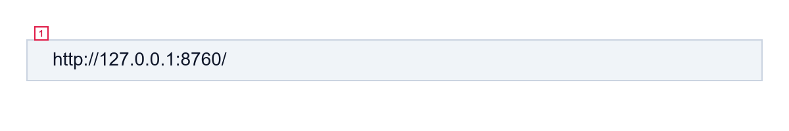

**图 1-1　浏览器地址栏里的访问地址。** ① 在这里输入 `http://127.0.0.1:8760/` 后回车；② 看到左侧出现「Case 列表」说明网页已经打开。

如果页面打不开，先确认浏览器地址没有写错，再联系管理员确认服务是否在运行。这一步不需要你执行任何命令。

## 1.2 第一次进入时设置显示名

第一次打开网页时，页面会弹出「设置显示名」。这个显示名只用于显示任务归属和 case 的占用者，**不是登录账号**，也不需要密码。

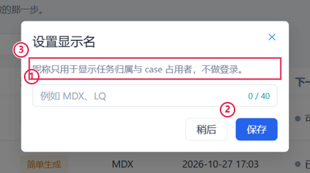

**图 1-2　设置显示名弹窗。** ① 填一个同事能认出你的名字；② 点确认；③ 这句话说明它不是账号系统，换浏览器或清空浏览器数据后需要重新设置。

显示名之后可以在「设置」页修改。换一台电脑或清除浏览器数据后，系统会把你当成新访客，之前占用的 case 也会显示为别人在用，这时重新设置一个显示名即可。

---

# 第二章　三条流程共用的页面

## 2.1 Case 列表页

左侧导航的第一项是「Case 列表」。页面副标题写着「每个 case 是一段素材加一条流程；点开后会进入当前该做的那一步。」

列表的每一行有六列信息，按顺序是 Case 名称、流程、负责人、最近活动、下一步和可用成片。行尾的「打开」按钮和点击整行效果相同。

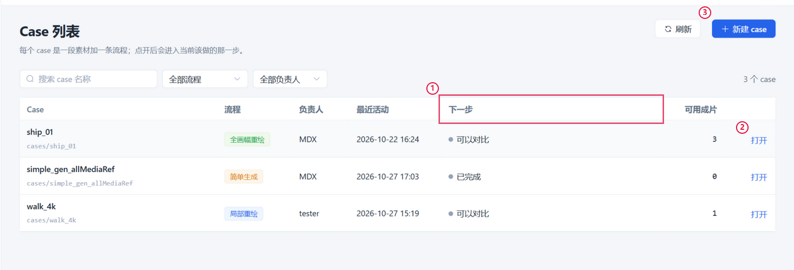

**图 2-1　Case 列表页。** ① 这一列直接告诉你这个 case 现在该做哪一步，点开就会跳到那一步；② 也可以点行尾的「打开」进入；③ 需要新开一个 case 时点这里。

「下一步」列会显示类似「等待素材」「可以生成」「已完成」的短语。新手最常见的困惑是打开 case 后不知道该点哪里，答案就在这里。

搜索框和两个下拉筛选用来在 case 变多之后找人找活。流程筛选有四个选项：全部流程、局部重绘、全画幅重绘、简单生成；负责人筛选按显示名过滤。

## 2.2 新建 case

点右上角「新建 case」，右侧会滑出一个抽屉，需要填三样东西。

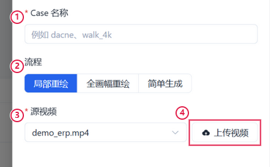

**图 2-2　新建 case 抽屉。** ① 名字用英文小写加下划线，例如 dacne、walk_4k，之后不方便改；② 选局部重绘或全画幅重绘；③ 从已有素材里挑源视频，只有简单生成流程不需要源视频；④ 源视频不在列表里时，点这里从本机上传。

1. 在「Case 名称」里填一个能认出内容的短名字。系统允许中文，但建议用英文小写与下划线，避免后续文件路径出问题。
2. 在「流程」里三选一。这一步决定后面看到几个步骤、每步做什么，创建后不能改流程。
3. 选择源视频。局部重绘与全画幅重绘必须有源视频；简单生成不显示这一项，改为显示「生成模式」。
4. 点「创建」。成功后会提示「已创建 X」，并自动跳到这条流程的第一步。

如果点「创建」没有反应，检查下面三句提示中的哪一句出现了：「先给 case 取一个名字」「sources/ 里还没有可选视频」「先选择生成模式」。

## 2.3 上传源视频与素材

上传入口有两处：新建 case 时源视频旁的「上传视频」，以及 case 内的「素材库」页签里的「上传素材」。两处打开的是同一个上传弹窗。

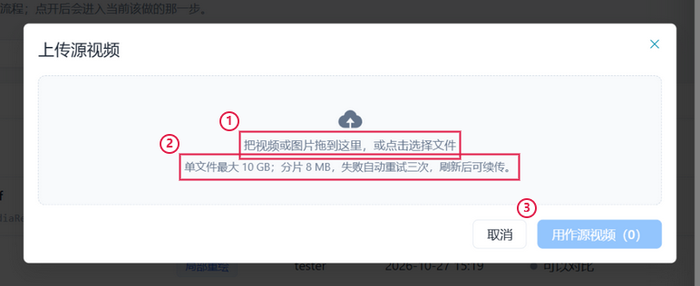

**图 2-3　上传弹窗与文件状态。** ① 把文件拖进来，或者点击这里选择文件；② 这句话说明大小上限与续传规则，超过 10 GB 的文件无法上传；③ 文件显示「已上传」之后才能点这个按钮。

- 支持的文件类型是 mp4、mov、mkv、avi 与 png、jpg、webp。其他类型会提示「只支持 mp4/mov/mkv/avi 与 png/jpg/webp」。
- 单个文件最大 10 GB。大文件会被切成 8 MB 的小块逐块上传，中途断网或刷新页面后重新打开弹窗可以接着传。
- 文件行会显示「等待上传」「上传中 N%」「已上传」「已取消」。显示「失败」时点该行的「重试」。
- 源视频一次只能选一个，新选的文件会替换掉之前选的。
- 上传过程中关闭弹窗会提示「还有文件在上传，关闭会中断这次上传」，此时点「继续上传」回到弹窗。

## 2.4 保存状态与 case 归属

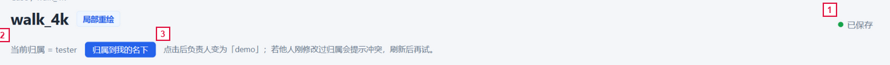

**图 2-4　case 页头部。** ① 离开页面前先确认这里是「已保存」；② 这一行显示当前归属，点 ③ 可以把 case 归到自己名下。如果这里出现「可能正在编辑」的提示，说明别人也在改同一个 case，先和对方确认由谁来改。

case 页面右上角有一个保存状态，显示「已保存」「保存中」或「未保存」。看到「已保存」再离开页面，可以避免丢失刚填的提示词与参数。

---

# 第三章　局部重绘

局部重绘适合「源片整体可用、只有一小块需要改」的情况，一共六步：选区、抽取、首尾帧、生成、合并、对比。页面顶部的步骤条会一直显示这六步，已经完成的步骤显示为完成状态。

## 3.1 选区：决定改画面里的哪一块

选区这一步做三件事：选择一个视口方向，在视口里框出一块区域，再定下要处理的帧范围。

页面分成左右两栏。左栏是「全景与视口」，副标题写着「点哪里，视口中心就在哪里」。右栏是「选区与抽帧范围」。

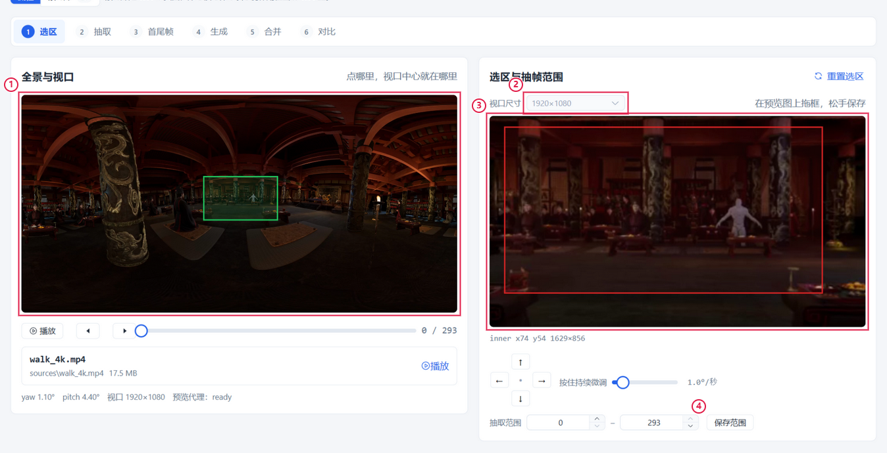

**图 3-1　选区页布局。** ① 在左侧全景画面上点一下，视口中心就移到你点的方向；② 选一个视口尺寸，尺寸选项由管理员配置；③ 右侧预览图里拖框决定实际改哪一块；④ 帧范围确认后点这里保存，保存成功后选区才算完成。

操作顺序固定为下面五步，跳步会导致后面的按钮点不动。

1. 在左侧全景画面上点一下，确定看哪个方向。可以用「播放」「暂停」和逐帧按钮找到动作最好的那一帧。
2. 在右栏「视口尺寸」里选一个尺寸。只有一项时不用选，说明系统只配置了这一种。
3. 在右侧预览图上按住鼠标左键拖动，画出一个框，松开鼠标即自动保存。框住的就是 AI 要重绘的范围。
4. 用方向摇杆 ↑←→↓ 微调视口。摇杆默认速度是 1.0°/秒，可以改小再微调。
5. 在「抽取范围」的两个数字框里填开始帧和结束帧，点「保存范围」。

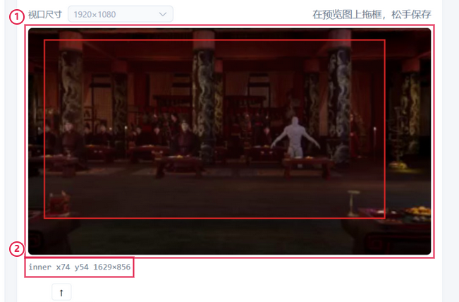

**图 3-2　在预览图上拖出选区。** ① 按住鼠标左键在预览图上拖出范围再松手，选区随即保存；② 这里显示选区在画面里的内接矩形与像素尺寸，数值变化说明选区已更新。

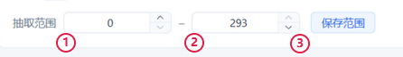

**图 3-3　抽取范围与保存范围。** ① 从这里开始处理；② 到这里结束，结束帧必须大于开始帧；③ 点这里把选区与帧范围一起存下来。

帧范围填错时页面会提示「帧范围要在 0–N 之间，且开始小于结束」，按提示改成合法数字再保存。选区保存失败时提示「保存选区失败」，先刷新页面重试，仍然失败再找管理员。

## 3.2 抽取：把选区固定成后续步骤的输入

抽取会把选区、帧范围和遮罩固定成一个版本，后续的首尾帧与生成都以这个版本为准。

页面顶部是版本条，显示当前版本与两个状态：✓ 选区已保存或选区未完成，✓ 抽取已完成或抽取未完成。右边是「运行抽取」按钮，已有版本时显示为「重新抽取」。

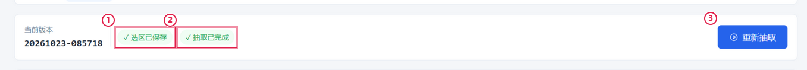

**图 3-4　抽取页顶部与运行按钮。** ① 这个标记没亮时，运行按钮点不动；② 这个标记亮起表示这一步已经完成；③ 两个标记都亮之后，点这里生成抽取结果。

抽取完成后，页面中部的「本次产物」会出现四张卡片：clip.mp4 是可以直接播放的片段，clip_mask.png 是区域遮罩，clip.json 是片段记录文件，首尾原始帧是两张 png，作为首尾帧步骤的底图。任何一张显示「文件缺失」都说明抽取没有真正完成，需要重新抽取。

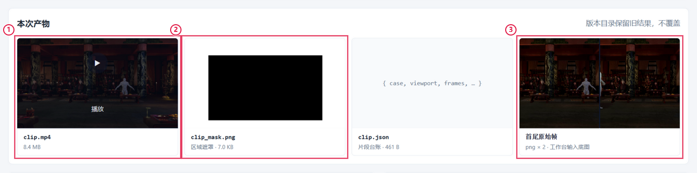

**图 3-5　本次产物四张卡片。** ① 点击可以播放，用来确认选区框对了没有；② 这张黑白图是遮罩，白的地方会被重绘；③ 这两张图是首尾帧步骤的输入底图，必须存在。

下半页的「抽取版本」列出所有历史版本，每个版本标注「当前」「有生成结果」或「未生成」。切换版本会同时切换首尾原始帧与后续步骤的输入，旧版本不会被清除。如果只是想看之前的效果，切换版本是安全的；但切换之后要重新检查首尾帧。

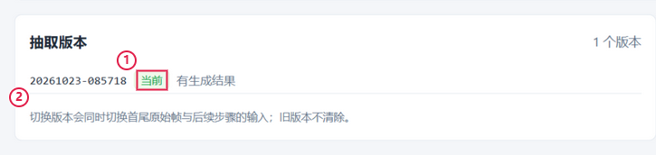

**图 3-6　抽取版本列表。** ① 当前生效的版本；② 这句话提醒切换版本之后要重新检查首尾帧。

「最近一次抽取任务」显示排队位置、状态和日志。完成时提示「抽取完成」，失败时提示「抽取失败，原因见下方任务日志」，把日志尾部的内容发给管理员即可定位。

## 3.3 首尾帧：先定首帧，再定尾帧

首尾帧这一步为 AI 准备两张关键图片：人物在动作开始时的样子，以及动作结束时的样子。生成视频时，AI 让画面从首帧过渡到尾帧。

页面顶部有「首帧」「尾帧」两个切换项，默认停在首帧。右上角是「交接给视频步」按钮，两张图都定稿之前它是灰的。

页面中部的「图片步输入」有四格，从左到右依次是图1 原始首帧、图2 参考图组、图3 首帧定稿和目标首帧定稿。尾帧步骤的四格内容换成尾帧，图3 会说明是「尾帧步骤插入」。

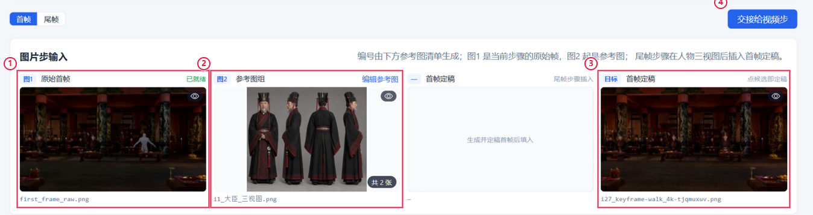

**图 3-7　图片步输入四格。** ① 这张图由抽取自动产生，平时不用动；② 这里放人物三视图，缺图时会警告「缺少人物三视图；先添加一张并设为主三视图」；③ 你要从候选里挑一张放到这里，这一步叫定稿；④ 首尾两张都定稿后才能点。

操作顺序如下。

1. 准备参考图。在「参考图清单」里点「添加参考图」，角色选「人物三视图」，备注写清它负责什么细节。缺三视图时，生成候选的按钮点不动。
2. 在「首帧候选」区域确认分辨率与数量。分辨率下拉有 1K、2K、4K，默认 2K；数量默认 4，最多 4 张。
3. 点「生成首帧候选」，等待任务完成。每生成一批会留下一个批次，更早的批次折叠在「更早的批次（N）」里。
4. 从候选图里点一张中意的，它就立即成为首帧定稿，图上出现「已定稿」角标。此时页面会自动切到尾帧。
5. 点「生成尾帧候选」，再点一张定稿。提示会依次出现「首帧已定稿；尾帧不会自动生成，点「生成尾帧候选」提交」和「尾帧已定稿」。
6. 点右上角「交接给视频步」，提示「已交接给视频生成」，两张定稿图进入生成步的素材清单。

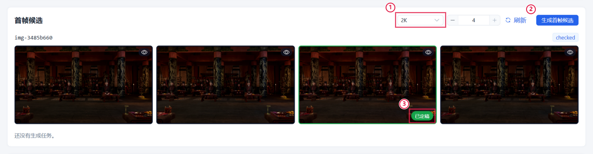

**图 3-8　首帧候选与定稿角标。** ① 分辨率越高画质越好、生成越慢；数量决定一次出几张候选；② 点一次消耗一次额度，确认参数后再点；③ 点任意一张候选即定稿，不用再点保存。

按钮点不动时，页面会给出原因：缺图时是「先完成抽取并准备两张原始帧」，缺三视图时是「先添加一张人物三视图并设为主三视图」，尾帧步骤在首帧未定时是「先生成并挑选首帧定稿」。按提示补齐即可。

页面底部的「图片步提示词」有「完整提示词（含参考图分工）」和一组变量卡。改动会自动保存，不需要点保存按钮。

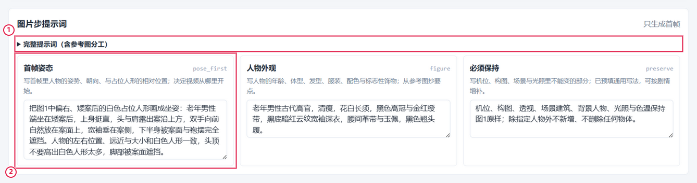

**图 3-9　首尾帧提示词。** ① 展开能看到模板正文；② 这里填的是每张参考图负责什么细节，改动会自动保存。

## 3.4 生成：预演检查，再正式提交

生成这一步把提交清单、提示词与参数交给 AI，等待一段视频回来。**这一步会消耗额度，正式提交之前先用预演检查确认参数。**

页面左栏是「本次视频提交」，列出要交给 AI 的素材。右栏是「最近成片」「生成记录」「最近任务」三块。页面底部固定一条提交栏。

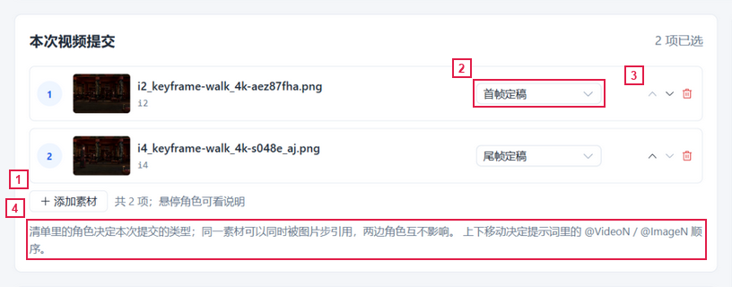

**图 3-10　提交清单与素材角色。** ① 从素材库挑素材加入清单；② 首尾帧流程里角色应为「首帧定稿」「尾帧定稿」；③ 上下移动决定提示词里 @VideoN 与 @ImageN 的编号顺序；④ 这句说明解释了为什么顺序重要。

提示词不在页面上直接编辑，需要点「展开编辑」，在右侧抽屉里改，改完点「保存并关闭」。抽屉里有「完整提示词（只读）」和若干变量输入框，模板正文不能改，能改的只有变量。

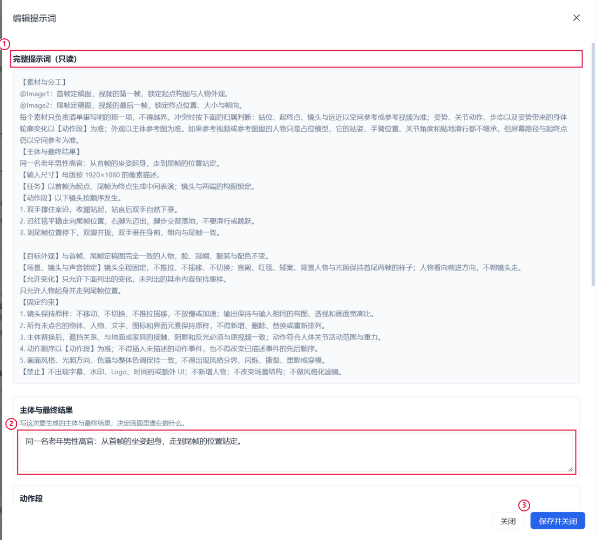

**图 3-11　编辑提示词抽屉。** ① 这段是模板正文，不能直接改；② 这里填的是变量，模板会把变量插进正文；③ 不点保存直接关闭会丢失这次的改动。

底部提交栏从左到右依次是模式、比例、输出分辨率、输入分辨率、时长、项目、剧集、会话和刷新按钮。局部重绘的首尾帧模式默认是 firstLastFrame，比例默认 16:9，输出分辨率默认 1080p，输入分辨率默认自动，时长默认自动。

**图 3-12　底部提交栏。** ① 决定成片清晰度，1080p 是常用档；② 时长选自动时由素材决定，括号里会显示预计秒数；③ 先点这个，不扣费；④ 预演通过之后再点这个，会扣费并开始排队。

按下面顺序提交。

1. 检查提交清单。首尾帧模式必须正好一张首帧定稿和一张尾帧定稿，不能带视频或遮罩。
2. 检查提示词与参数。任何改动都会让已经通过的预演变成「预演已过期」，需要重新预演。
3. 点「预演检查（不扣费）」。状态会从「预演中」变为「预演通过」。
4. 点「提交生成」。状态依次变为「提交中」「排队中」「运行中」「已完成」。
5. 在「生成记录」里找到可用结果，点「选用成片」，提示「已采用成片」。

**图 3-13　预演通过与提交按钮。** ① 这个状态出现才说明参数能提交；② 这句说明表示刚才的预演仍然有效；③ 此时点提交才会真正扣费。

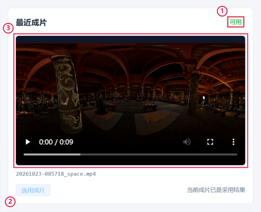

**图 3-14　生成记录与选用成片。** ① 只有标着「可用」的轮次才能选用；② 点这里把这个结果定为本次采用的结果，后续合并只认采用的结果；③ 选用后这里会出现成片，可以直接播放确认。

**关于扣费与等待。** 预演检查不扣费，也不产生视频；正式提交才开始扣费。排队时间取决于当时的任务量，排队位置、运行状态与失败原因都能在生成页的「最近任务」里看到。

## 3.5 合并：把 AI 片段贴回原片

合并会把 AI 生成的片段放回原来的全景视频里，并自动完成时间上的拼接。页面左栏是「合并与时间拼接」，右栏是「成片」与「最近任务」。

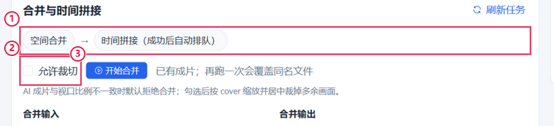

**图 3-15　合并页面与开始合并。** ① 说明这一步分两件事做，时间拼接会自动排队，不用再点；② 默认不勾，勾选后允许把比例不一致的画面裁掉一部分；③ 必须先选用过一次生成结果，这个按钮才能点。

没有选用过结果时，按钮旁边会提示「先采用一次生成结果」。已有成片时页面会提示「已有成片；再跑一次会覆盖同名文件」，需要保留旧成片时先改名或另存。

页面下方分「合并输入」与「合并输出」两块。输入是原片与采用的 AI 片段，输出是合并后的成片，每行显示文件名、路径、大小，并带「播放」「打开」。缺失时标「文件缺失」。

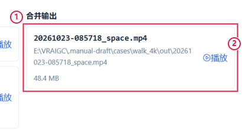

**图 3-16　合并输出。** ① 这里列出刚生成的成片；② 点播放先确认内容。右侧成片面板上的「整片」表示时间拼接已完成，「仅中间段」表示还有一段没有拼上。合并后的成片保存在这个 case 目录的 `out\` 下。

## 3.6 对比：左右两路同步播放

对比页把原片和成片放在一起播放，用一条分割线左右切换。左路固定是源片，右路是选中的成片。

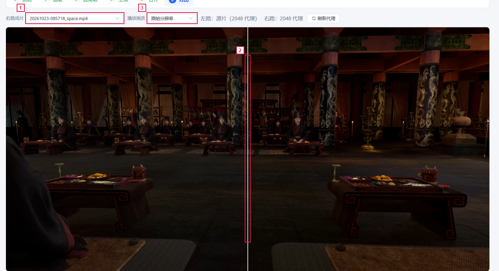

**图 3-17　对比页。** ① 一个 case 可能有多个成片，这里选要看的那一个；② 在画面上左右拖动这条线，就能对比同一时刻的两路画面；③ 默认原始分辨率，网络或性能不够时切到代理。

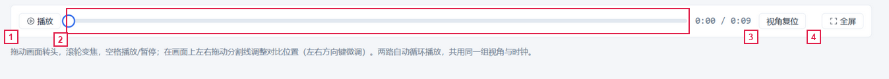

**图 3-18　底栏播放控制。** ① 空格键也能播放或暂停；② 两路共用同一条时间轴；③ 转头转乱了点这里回到初始视角；④ 全屏后更好检查接缝。

操作方式：在画面上拖动鼠标可以转头，滚轮缩放，按空格播放或暂停，按左右方向键微调分割线位置，点「视角复位」回到初始视角。两路会自动循环播放，并且共用同一组视角与时钟。

浏览器不支持 WebGL 时页面会提示「这个浏览器不支持 WebGL，全景对比看不了」，换 Chrome 或 Edge 的新版本即可。

---

# 第四章　全画幅重绘

全画幅重绘适合「整段画面都要重画、但镜头运动要保留」的情况。它只有四步：扩充画面、生成、裁回原尺寸、对比。

**为什么需要先扩充再裁回。** AI 生成视频时只接受固定的宽高比，而全景视频是 2:1 的。直接生成会在左右接缝处出现断裂，所以系统先把画面左右各复制一段做冗余，加遮罩后交给 AI，生成完成后再按记录把冗余部分裁掉，接缝就落在可接受的位置。

## 4.1 扩充画面

页面只有一个主面板「扩充与裁回」，里面是流程条「扩充画面 → 生成 → 裁回原尺寸」和两个按钮。扩充比例由系统固定为 21:9，页面上没有比例输入框，不需要找。

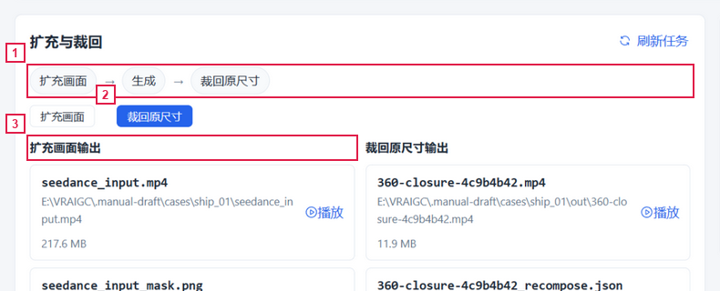

**图 4-1　扩充与裁回面板。** ① 三个动作的顺序就写在这里；② 点一次即可，参数由系统决定；③ 完成后这里会列出三个文件。

1. 确认这个 case 已经有源视频。没有源视频时按钮是灰的。
2. 点「扩充画面」。完成时弹出「任务完成」。
3. 在「扩充画面输出」里确认三个文件都在：seedance_input.mp4、seedance_input_mask.png、seedance_input_pad.json。

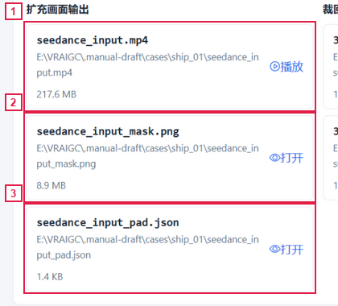

**图 4-2　扩充输出的三个文件。** ① 这是交给 AI 的扩充后视频，点播放可以确认左右多出了冗余画面；② 遮罩决定哪些区域允许被重画；③ 这个文件记录了几何信息，裁回时要靠它，不要删除。

没有扩充过画面时，页面会提示「还没有扩充过画面；先扩充，生成步才可用」。失败时提示「任务失败，原因见下方日志」。

## 4.2 生成

全画幅重绘的生成页与局部重绘共用同一套界面，差别有三处。

- 首屏默认模式是 videoEdit，比例是 21:9，输出分辨率是 1080p。
- 提交清单里必须包含扩充后的视频，也就是 seedance_input.mp4，并且要勾选上。
- 不需要首尾帧定稿图。

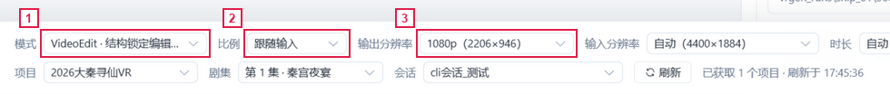

**图 4-3　全画幅生成的参数条。** ① 这个模式会尽量保留原片的动作；② 比例默认「跟随输入」，实际比例由扩充后的母版决定，大约是 21:9，不要手动改成 16:9；③ 清晰度按需要选择。

清单为空时按钮下方会显示「提交条件未满足：没有勾选任何素材——至少勾选一项再生成」。把扩充后的视频加入清单并勾选后，按「预演检查（不扣费）」然后「提交生成」的顺序操作，与局部重绘相同。

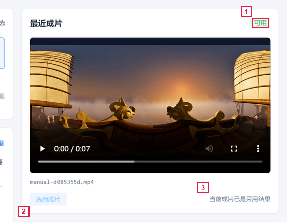

**图 4-4　全画幅生成记录与选用成片。** ① 只有这一轮能选；② 点这里定下采用结果；③ 看到这句提示才能去裁回。

## 4.3 裁回原尺寸

裁回原尺寸会把 AI 结果按扩充时记录的几何信息配准、混合，并去掉左右冗余，恢复到原片的尺寸与画幅。

回到「扩充与裁回」页面，点「裁回原尺寸」。如果还没有选用过生成结果，按钮点不动，并提示「采用结果后才能裁回原尺寸」。

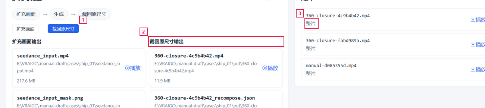

**图 4-5　裁回原尺寸按钮与输出。** ① 点一次即可，完成时提示「任务完成」；② 这里会出现 mp4 与 _recompose.json 两个文件；③ 标「整片」表示这份成片可以直接交付。裁回后的成片保存在这个 case 目录的 `out\` 下。

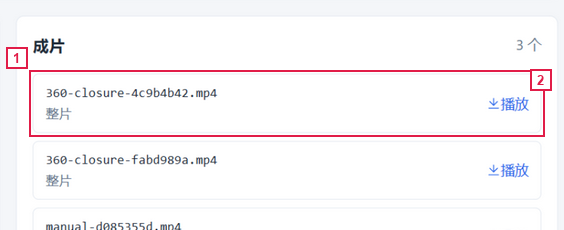

**图 4-6　裁回后的成片。** ① 文件名以采用的轮次命名；② 播放确认接缝是否自然。

## 4.4 对比

全画幅重绘的对比页与局部重绘完全相同，左路是源片，右路是裁回后的成片。操作方式也相同：拖动画面转头、滚轮缩放、空格播放暂停、左右拖动分割线。

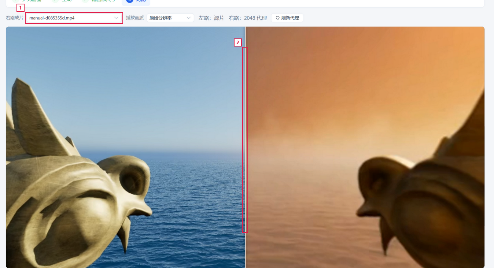

**图 4-7　全画幅成片的对比。** ① 选刚裁回的那一份；② 重点看这里有没有断裂或明显色差；③ 播放一遍完整看一次。

---

# 第五章　简单生成

简单生成只有一步：生成。它不需要源视频，也不需要选区与首尾帧，适合按提示词新做一段视频。

## 5.1 新建时选择生成模式

新建 case 时如果流程选「简单生成」，源视频一项会消失，换成「生成模式」下拉。模式决定 AI 怎么理解你给的素材。

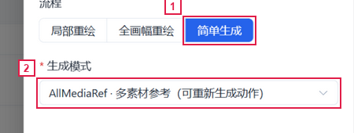

**图 5-1　简单生成新建时的模式下拉。** ① 先选这条流程；② 点开这里选模式，四个模式分别对应下面的说明。

- VideoEdit 是结构锁定编辑，尽量跟随输入视频的动作，适合只改风格或局部内容。
- AllMediaRef 是多素材参考，可以重新生成动作，适合给多张参考图让它重新编排。
- VideoExtend 是延长视频，把已有视频接长。
- FirstLastFrame 是首尾帧生视频，给首尾两张图让它过渡。

下面四张图都只拍底部提交条左侧的一小块，用来对照每个模式在参数条里的显示。

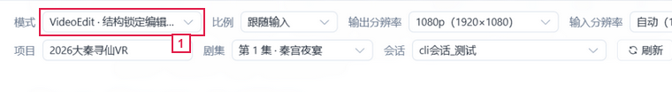

**图 5-2　VideoEdit 模式的参数条。** ① 显示 VideoEdit 说明正处在结构锁定编辑模式；这个模式下清单里必须有一个视频母版。

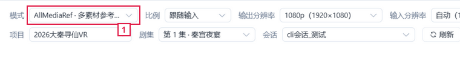

**图 5-3　AllMediaRef 模式的参数条。** ① 显示 AllMediaRef 说明处在多素材参考模式；这个模式下每张参考图都要指定角色，AI 会按角色理解它们的分工。

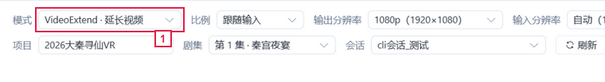

**图 5-4　VideoExtend 模式的参数条。** ① 显示 VideoExtend 说明处在延长视频模式；延长后时长会变化，选自动时括号里会显示预计秒数。

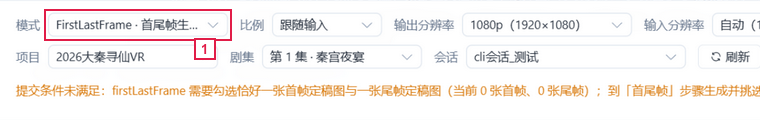

**图 5-5　FirstLastFrame 模式的参数条。** ① 显示 FirstLastFrame 说明处在首尾帧生视频模式；清单里第一张要设为首帧定稿，第二张要设为尾帧定稿，多一张少一张都不能提交。

模式创建后写在 case 里，之后可以在生成页的提交条里换，但换了之后要重新检查素材角色是否仍然合法。

## 5.2 生成页总览

简单生成打开后直接就是生成页，页面结构与局部重绘的生成页相同，左侧是「本次视频提交」与「提示词」，右侧是「最近成片」「生成记录」「最近任务」，底部是提交条。顶部有「流程」「素材库」两个切换项。

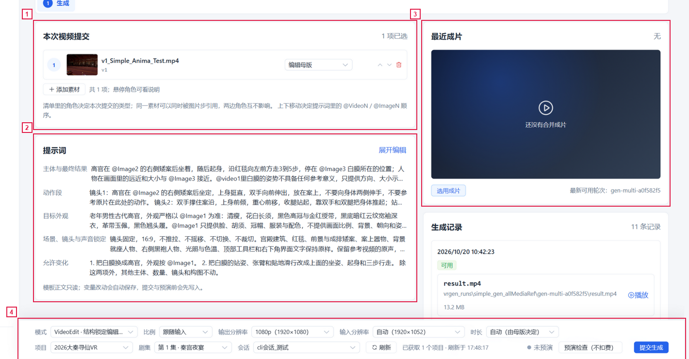

**图 5-6　简单生成页。** ① 在这里决定交给 AI 哪些素材；② 在这里改提示词变量；③ 完成后在这里看结果并选用；④ 在这里设参数并提交。

## 5.3 添加素材与选择角色

点「添加素材」，从素材库挑选，底部会显示「已选 N 项」和「添加」按钮。加入清单后每一项都要选一个角色。

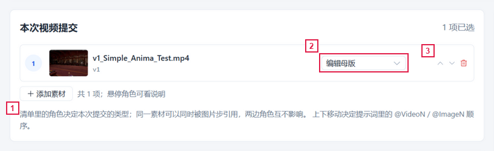

**图 5-7　素材清单与角色。** ① 从这里打开素材挑选弹窗；② 角色决定 AI 把这段素材当母版、主体还是动作参考；③ 顺序决定提示词里的编号。

需要视频母版的模式（例如 VideoEdit）必须恰好带一个视频母版；FirstLastFrame 需要恰好一张首帧定稿和一张尾帧定稿，并且不能带其他素材；AllMediaRef 可以同时带多张参考图。缺什么时按钮下方会直接写出原因。

## 5.4 填写提示词变量

提示词模板的正文是只读的，你只能填变量。点「展开编辑」打开抽屉，逐个填写变量输入框，点「保存并关闭」。变量改名或新增要通过「添加变量」完成。

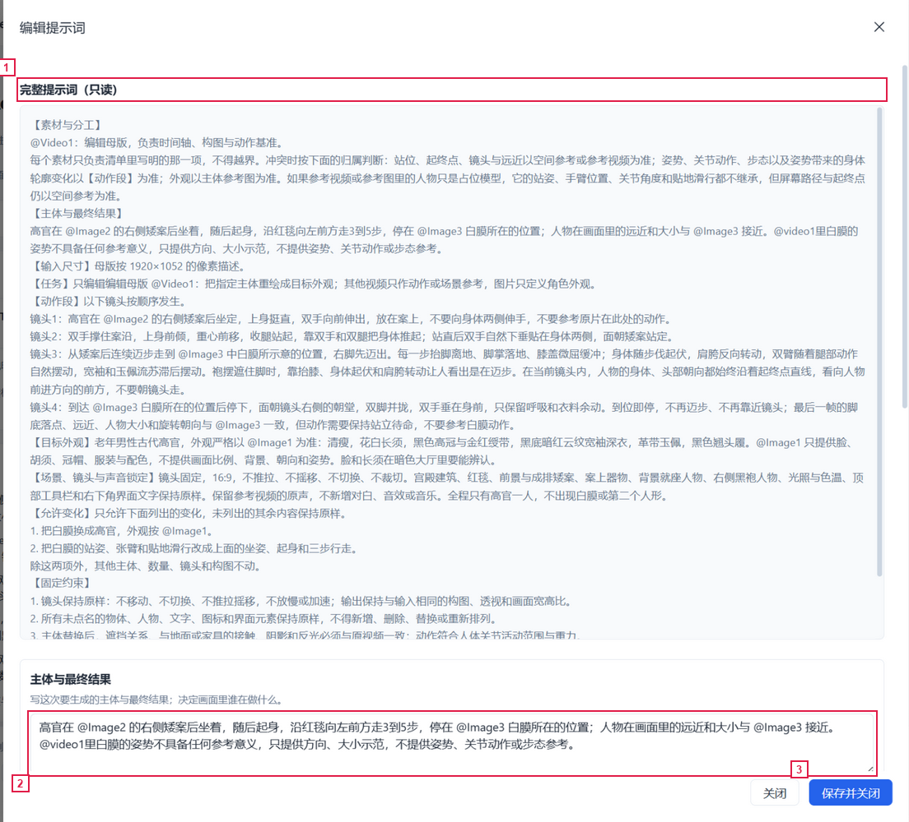

**图 5-8　简单生成的提示词抽屉。** ① 这段模板正文只读；② 在变量输入框里写具体内容；③ 改完点这里保存。

## 5.5 设置参数并提交

底部提交条与局部重绘相同：模式、比例、输出分辨率、输入分辨率、时长、项目、剧集、会话、刷新。

**图 5-9　简单生成的提交条。** ① 换模式后素材角色可能失效，要重新检查；② 比例按用途选，社交平台常用 16:9；③ 先预演，不扣费；④ 预演通过后再正式提交，会扣费。

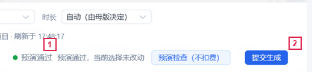

**图 5-10　简单生成的预演通过。** ① 这个状态出现表示参数可用；② 此时提交才会真正开始生成并扣费。

## 5.6 查看结果与选用成片

生成完成后，右栏「生成记录」会列出每一轮的结果，标「可用」的轮次可以选用。点「选用成片」把它定为本次结果，「最近成片」里会出现播放器。

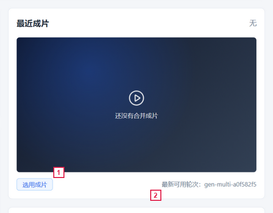

**图 5-11　生成结果与选用成片。** ① 点这里把最近一轮可用结果定为采用结果；② 这里显示最近一次可用的轮次编号。

页面没有单独的下载按钮。简单生成的结果保存在这个 case 根目录的 `result.mp4`，采用记录写在 `case.toml` 里。

---

# 第六章　三条流程怎么选

三条流程的差别可以用一句话概括：局部重绘改一块，全画幅重绘改全部，简单生成重新做。

- **局部重绘**需要源视频，需要做选区、抽取、首尾帧，共六步，最终产物是贴回原片的成片。它最费时间，但改动最精准，原片没被选中的部分一个像素都不动。
- **全画幅重绘**需要源视频，需要先扩充再裁回，共四步，最终产物是裁回原尺寸的整片。它适合整段画面都要换风格的情况，接缝靠扩充与裁回处理。
- **简单生成**不需要源视频，也不需要选区，只有一个生成步骤，最终产物是 AI 直接生成的视频。它最快，但与原片没有对应关系。

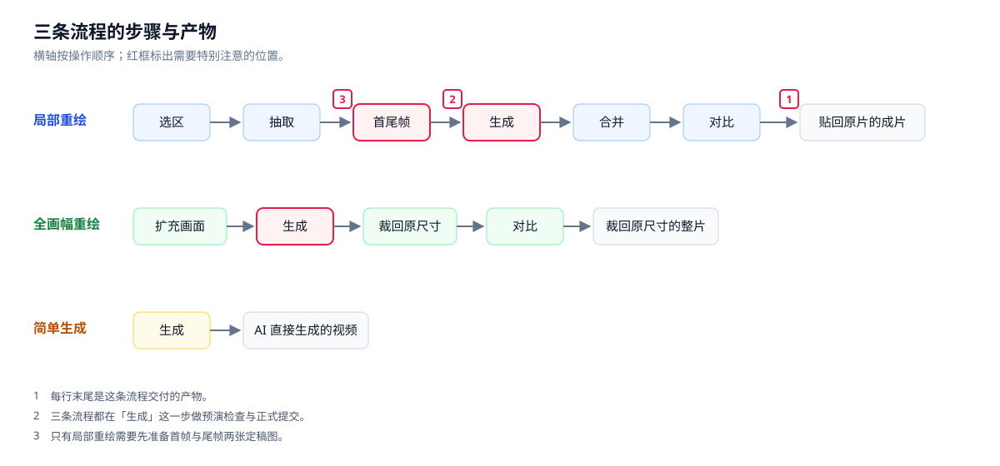

**图 6-1　三条流程的步骤与产物对照图。** ① 产物决定这条流程最终交什么；② 三条流程在这一步都要预演与提交；③ 只有局部重绘需要准备首尾帧定稿图。
